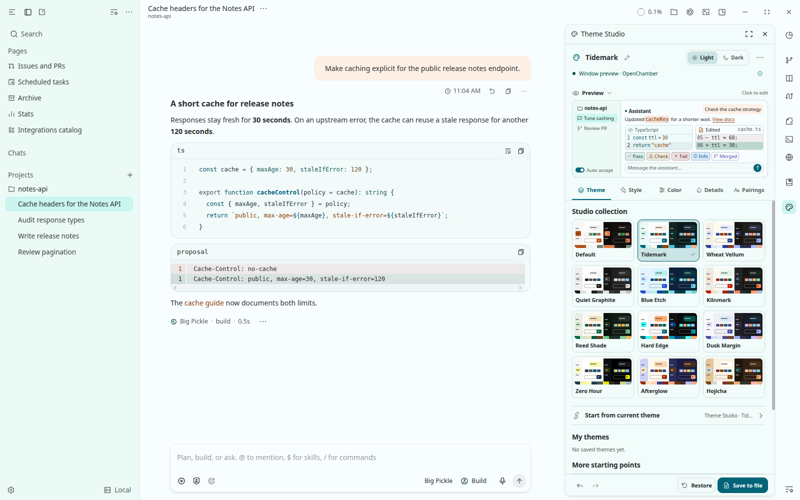
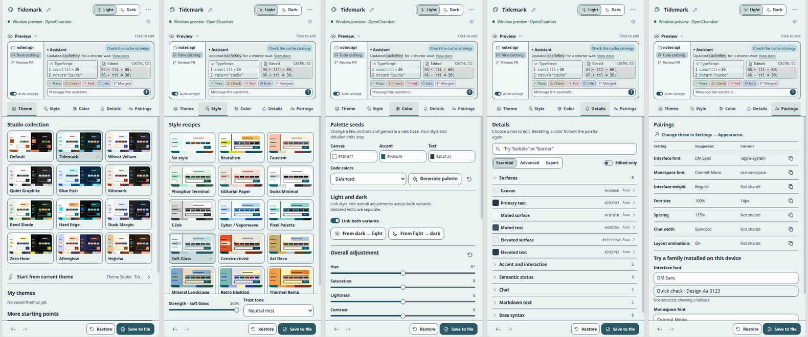
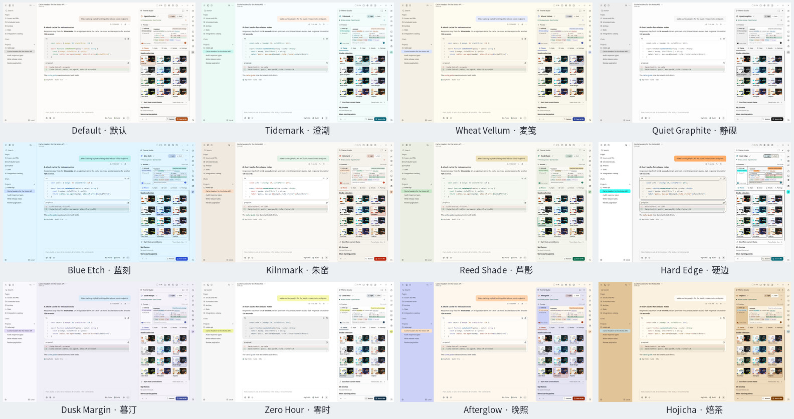
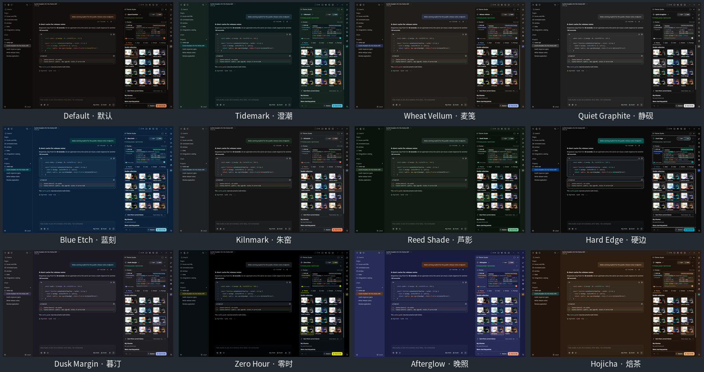
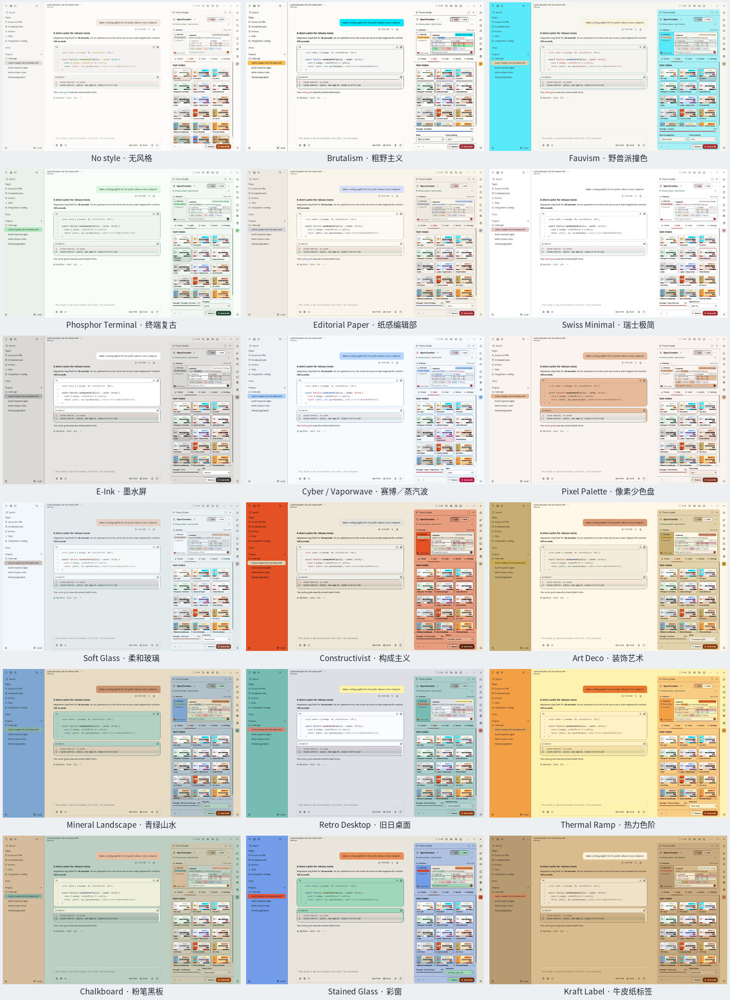
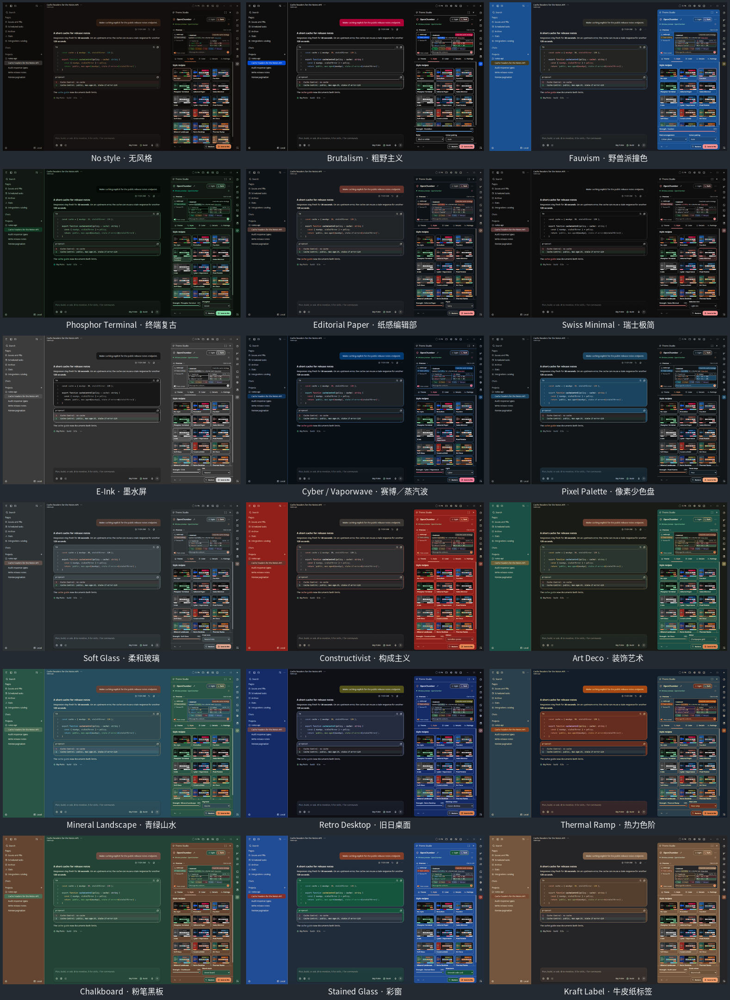

# Theme Studio for OpenChamber

**English** · [简体中文](README.zh-CN.md)

Design and preview native **OpenChamber** themes from the right sidebar. Pick a palette, layer a style, tune the colors, refine chat bubbles and code. The whole window previews each change as you go. **Click to preview, Save to keep a theme of your own, Restore to go back to where you started.**



---

## Features

- **Whole-window live preview.** Clicking a palette, style or slider repaints the OpenChamber window, usually within a few seconds. The mini preview in the panel updates instantly. You can preview either the light or the dark edition, whatever mode the window is in.
- **12 curated palettes, each with a light and a dark edition.** Default (OpenChamber's own colors), Tidemark, Wheat Vellum, Quiet Graphite, Blue Etch, Kilnmark, Reed Shade, Hard Edge, Dusk Margin, Zero Hour, Afterglow and Hojicha. You can also start from any of OpenChamber's 31 built-in theme pairs, or from the theme you are using now.
- **17 composable style recipes** with adjustable strength, layered on whichever palette you picked (see [Style recipes](#style-recipes)).
- **Five tabs.** **Theme** picks a starting point. **Style** layers a recipe. **Color** tunes seed colors, hue, chroma, lightness, contrast and temperature, globally or per group, and includes a readability check with one-click repair. **Details** edits every visible theme field, with an inline picker and contrast against the related background. **Pairings** tries local fonts and suggests sizes and spacing to copy into OpenChamber's settings.
- **Colors from an image**, **Random inspiration**, or import an existing OpenChamber theme JSON.
- **Your themes stay yours.** Save writes a pair of native theme files that appear under **My themes** and in **Settings → Appearance**. Theme Studio never rewrites a theme you named.
- **Reversible.** One **Restore** returns both the light and the dark edition to how they were before you started previewing. Since 0.3.1 this also works after an accidental uninstall and reinstall.
- **Follows OpenChamber's language.** The panel is in English or Chinese, and switches with the host's interface language.
- **Fits any sidebar width.** At 320 px the cards sit in two columns. On wide panels each card is at most 240 px, the column count grows with the width, and the Theme and Style tabs line up.
- **No dependencies, no service.** A single static panel script. No `npm install`, no background process. It does not modify OpenChamber or its settings.



## Curated palettes

Each palette is shown as an unedited capture of OpenChamber 2.8.0 previewing it.

<details open>
<summary><b>Light editions</b></summary>



</details>

<details>
<summary><b>Dark editions</b></summary>



</details>

## Style recipes

A style is not a theme. It is a recipe applied to the palette you picked, so the same style looks different on Tidemark and on Hojicha. The previews below layer each recipe on the Default palette at its default strength.

| | |
| --- | --- |
| **Original nine** | Brutalism, Fauvism, Phosphor Terminal, Editorial Paper, Swiss Minimal, E-Ink, Cyber / Vaporwave, Pixel Palette, Soft Glass |
| **Added in 0.3** | Constructivist, Art Deco, Mineral Landscape, Retro Desktop, Thermal Ramp, Chalkboard, Stained Glass, Kraft Label. These are told apart by large color planes on the canvas, sidebar and code blocks. Bubbles, selection and accents follow your palette. |

<details open>
<summary><b>Light</b></summary>



</details>

<details>
<summary><b>Dark</b></summary>



</details>

---

## Install

Requires **OpenChamber 2.8.0 or later**. It is verified on the 2.8.0 desktop app (Electron) and web app on Linux.

1. In OpenChamber, open **Settings → Extensions** and paste this repository's Git URL into **Folder, ZIP, or URL**:
   ```text
   https://github.com/JMoCoder/openchamber-theme-studio
   ```
   You can also paste the URL of `theme-studio-<version>.zip` from [Releases](https://github.com/JMoCoder/openchamber-theme-studio/releases), or unzip it somewhere permanent and enter the `theme-studio` folder.
2. Choose **Add**, then **Allow and enable**. OpenChamber shows the panel only after you approve it.
3. Click the **palette icon (Theme Studio)** in the right sidebar.

**Upgrading:** add the new version in **Settings → Extensions**. When OpenChamber reports the same name, choose **Reinstall**. You do not need to remove the old version first, and a preview started by the old version can still be restored.

### Permissions

The approval dialog lists `filesystem` access to three places:

| Path | Why |
| --- | --- |
| `~/.config/openchamber/themes`, `theme-studio-*.json` inside it | Read the theme folder, and write the preview files and the themes you save |
| `~/Downloads`, `~/下载`, `openchamber-theme-studio-*.json` inside them | Write an exported file, only when you choose **Export** |

An existing file with the same name but without Theme Studio's marker is never replaced. The extension starts no service and does not change OpenChamber's program files or settings.

---

## How it works

### Preview, Save, Restore

- **Preview.** Clicking a card or editing in any tab previews it across the window. This works while the window uses a recognizable built-in theme or Theme Studio's own live theme. If you use a theme of your own, or the theme cannot be identified, the mini preview still works. Turn **Live window preview** off or on in the **⋯** menu in the top-right corner. Opening the panel, switching tabs or languages, or rechecking files never starts a preview.
- **A dark edition in a light window, or the other way round.** Theme Studio writes the edition you picked into **its own preview file**, and the window reads it in its current mode. Your window mode and your named themes stay as they are. Input borders, shadows and a few native controls are still drawn for the window's mode. To see the final result, switch the mode in **Settings → Appearance**. **Save, export and copy always use the theme's real light and dark editions.**
- **Default is not Restore.** The first card on **Theme**, **Default**, gives you OpenChamber's factory colors and clears styles, tuning and refinements. **Restore**, in the footer, returns to the theme and window you had before you started previewing. It handles both editions at once. If you started from Flexoki, Default gives you OpenChamber's own colors and Restore gives you Flexoki back.
- **Save to file.** Name the theme and choose light, dark or both. Each edition becomes a standalone native theme file. Keep experimenting afterwards; the saved copy is never rewritten. To use it every day, choose it once in **Settings → Appearance**.

A preview lasts until you restore it. Closing the panel, restarting or saving does not end it. While a preview borrows a built-in theme, other windows on the same server that use the same built-in also see it. Turn off **Live window preview** first if you do not want that. Theme Studio never changes which theme the host has selected.

### What a saved theme contains

A saved theme is an ordinary OpenChamber theme file with the final colors. It is the result of the whole pipeline: **palette × style × tuning × refinements**. It also carries an extra `themeStudio` field recording how it was made. OpenChamber ignores that field, but Theme Studio uses it, so opening the theme from **My themes** or importing the file lets you keep editing the style, tuning and details.

| To | Do this |
| --- | --- |
| Keep a theme | **Save to file**, then choose light, dark or both. The copy appears under **My themes** and in **Settings → Appearance**; a clashing name gets a number. |
| Tidy the list only | Click the bin on a theme and choose **Remove from My themes only**. The file stays usable in Appearance, and you can put it back from **Removed**. |
| Delete the file | The same bin lists the theme's name, editions and exact paths. Delete it in **Settings → Appearance**; OpenChamber 2.8 gives extensions no delete API. Theme Studio can then check what is left. |
| Take a file elsewhere | **⋯ → Export to Downloads** writes native JSON to `~/Downloads` or `~/下载` on the server. You can also **Copy JSON**. |
| Edit a file again | **⋯ → Import a theme**: pick, drop or paste JSON, up to 512 KiB. Unsupported fields are listed and ignored. |
| Install a theme without the extension | Put the exported JSON in `themes/` in the server's data folder (`~/.config/openchamber/themes/` by default) and choose it in **Settings → Appearance**. |

### What a theme can and cannot change

- **Applied directly:** canvas and sidebar backgrounds, cards and translucent surfaces, text, accents, borders, selection and hover, chat bubbles, code syntax, diff and status colors. Different components use these colors to different degrees.
- **Set in OpenChamber's own settings:** interface and monospace fonts, sizes, weights, spacing, chat width and layout motion. **Pairings** lets you try fonts and copy suggestions, but a theme file does not carry them.
- **Not exposed by the host:** background images, gradients or textures, square corners everywhere, border width, hard shadows, a separate heading font, free letter and line spacing, window transparency. Brutalism uses solid blocks, dark borders and high-contrast selection instead. It changes the whole window's feel, but rounded corners stay rounded.

The [field catalog](data/fields.json) classifies all 147 theme fields: 54 take effect everywhere, 65 in some places, and 28 have no visible effect.

---

## Restore and uninstall

**Uninstalling does not restore a preview.** OpenChamber removes the extension, but the window keeps reading the preview file. To get your original colors back:

1. Click **Restore** in the footer and wait until the window shows your original colors. Do not use **Delete** in Appearance instead.
2. If you chose a saved theme in **Settings → Appearance** yourself, switching away is up to you.
3. Then remove it in **Settings → Extensions → Theme Studio → Remove**. **⋯ → Clean up before uninstalling** walks you through the same steps. Your saved themes and exported files stay.

**Uninstalled during a preview? (0.3.1 and later)** Reinstall, open Theme Studio and click **Restore** once. Both editions come back: a Theme Studio live theme you had before is restored byte for byte, and a built-in theme gets its own colors back. You can also just keep previewing. Unsaved drafts that existed only in extension storage cannot be recovered, and named themes are never touched.

**A leftover preview from 0.3.0 or earlier** has no recorded starting point:

- **"Old preview to clear":** click **Restore built-in colors**. If a Theme Studio live theme was in that slot before, its content cannot be recovered. If both editions have leftovers, switch the host to each mode in turn.
- **"Original colors unavailable":** Theme Studio leaves the file untouched. Save the current colors if you want them, or switch themes in **Settings → Appearance**. You do not need to delete anything.

<details>
<summary>Recover built-in colors by hand, without reinstalling</summary>

In **Settings → Appearance**, switch the affected light or dark edition to another built-in theme (for example Flexoki). Remove only the entry the preview left behind, then choose your original built-in again. The entry's name depends on the language in use when you previewed:

- English: `Theme Studio · Tidemark (trying on)`
- Chinese: `Theme Studio · 澄潮（试穿）`

The palette name varies. Never delete a theme you named yourself, and do not delete anything you cannot identify.

</details>

## Status messages

- **"Could not read theme files":** your draft and the mini preview are kept. **Check files again** only reads. Afterwards, pick a card or keep editing to preview again.
- **"Default theme folder not found":** the panel still previews and copies. If the server uses a custom data folder, place JSON in its `themes/` by hand.
- **"Written · waiting for the app…":** give the host a moment. If no update is detected, check the current mode and the theme chosen in Appearance. **Retry** repeats only the last write.
- **"Window preview paused":** the theme you are using matches a built-in exactly, so Theme Studio tried its own file once. Your theme was not rewritten. **Paused is not undone:** the built-in in Appearance may still be marked `(trying on)`. Click **Restore** first, then pick a different theme in **Settings → Appearance**.

---

## Development

The panel is plain ES modules bundled by [Bun](https://bun.sh) into one IIFE, `panel/main.js`, kept under 600 KB. The built `panel/` is committed, so the repository installs as is, and rebuilding from this source reproduces it byte for byte.

```bash
npm install                       # installs the pinned @openchamber/sdk@2.8.0 used by the build
node scripts/build.mjs            # rebuild panel/main.js (needs Bun)
node --test                       # unit and integration tests
UI_PLAYWRIGHT=/path/to/playwright/index.mjs node scripts/ui-verify.mjs   # browser checks of the panel
node scripts/ui-serve.mjs         # local fixture of the panel with a mock host
```

Set `THEME_STUDIO_UPSTREAM` to a checkout of OpenChamber v2.8.0 to run the tests that compare against every upstream built-in theme. `scripts/dev-host.mjs` starts an isolated OpenChamber, desktop or web, with its own home, data folder and port. Use it for end-to-end checks instead of your everyday install. Design notes are in [docs/DESIGN.md](docs/DESIGN.md) and [docs/ui.md](docs/ui.md).

```text
openchamber-theme-studio/
├── package.json       # OpenChamber extension manifest (apiVersion 1)
├── panel/             # Built panel: index.html, main.js, style.css, builtins.js
├── src/
│   ├── core/          # Studio state, history, project model
│   ├── host/          # SDK host channel, live preview slots, theme library
│   ├── ui/            # Panel pages, dialogs, picker
│   ├── i18n/          # English and Chinese strings
│   └── data/          # Generated built-in theme index and defaults
├── shared/            # Theme core (ported from OpenChamber), derivation, style recipes
├── presets/           # The eleven curated palettes
├── data/fields.json   # Machine-readable catalog of theme fields
├── scripts/           # Build, generators, browser and isolated-host verification
├── docs/              # Design contract, UI notes, images
├── CHANGELOG.md
├── NOTICE.md          # Upstream notices
└── LICENSE            # MIT
```

## License

[MIT](LICENSE). Theme validation and CSS generation are ported from OpenChamber v2.8.0, and the built-in themes come from the same release. See [NOTICE.md](NOTICE.md).
