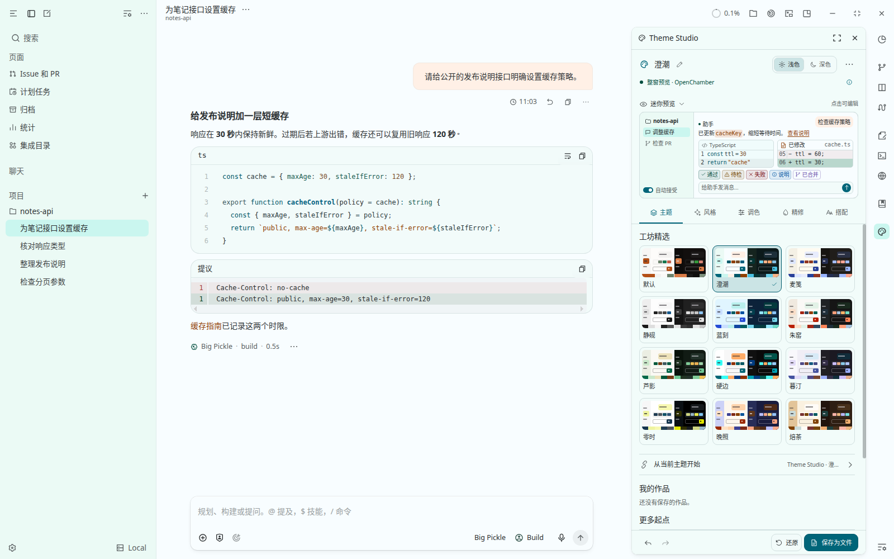
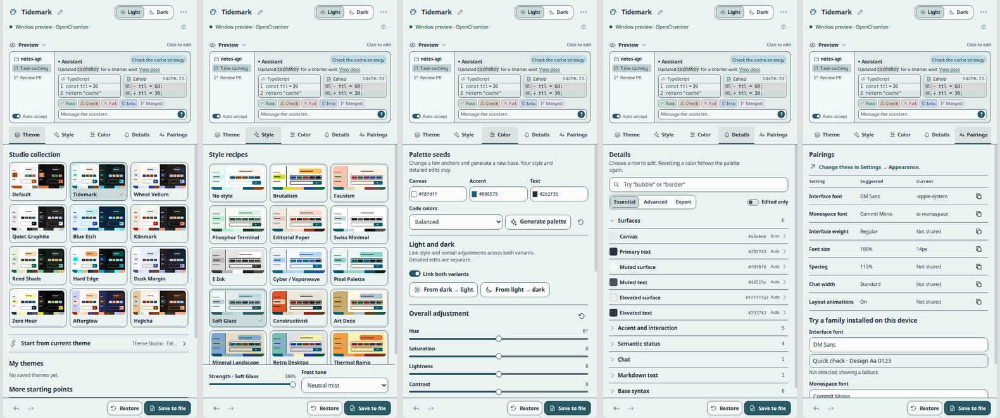
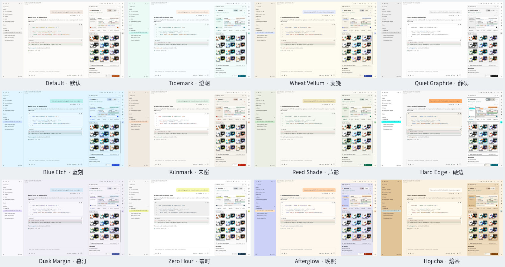
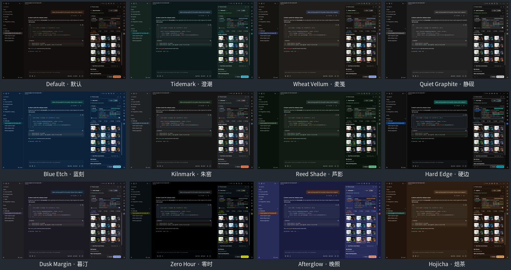
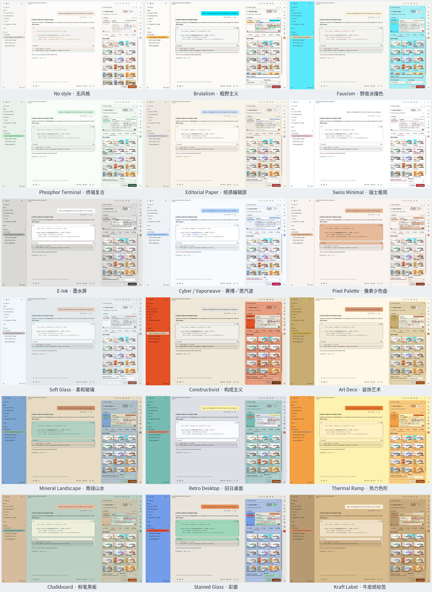
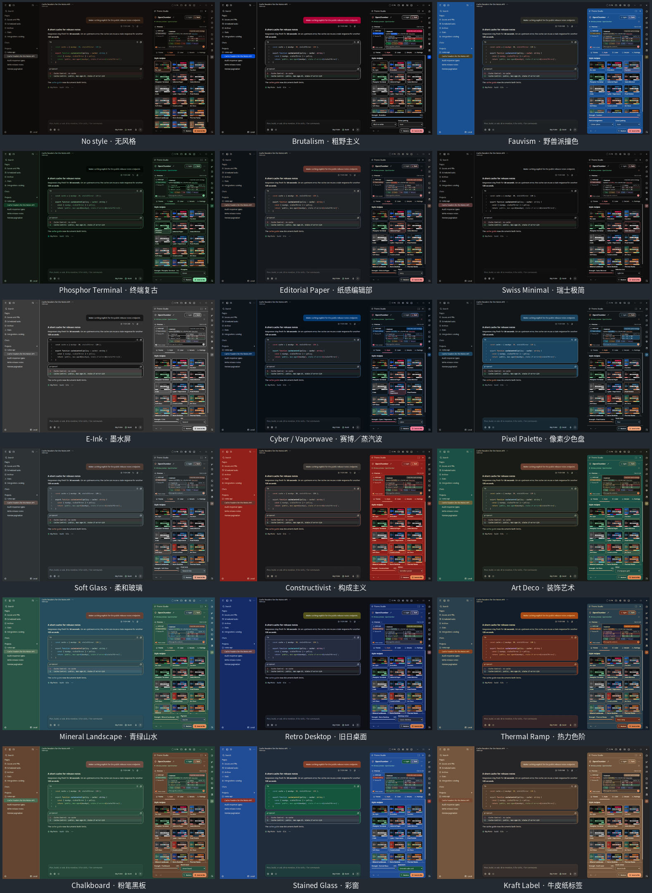

# 主题工坊 · Theme Studio for OpenChamber

[English](README.md) · **简体中文**

在 **OpenChamber** 的右侧边栏设计、预览原生主题：挑一套配色，叠一层风格，调整颜色，再精修聊天气泡和代码配色。每一步改动都会实时显示在整个窗口上。**点选就是预览；「保存为文件」才留下你自己的主题；「还原」回到开始预览前的样子。**



---

## 功能

- **整窗实时预览。** 点配色、风格或拖滑杆，OpenChamber 整个窗口随之换色，通常几秒内生效；面板里的迷你预览即时更新。不论窗口当前是浅色还是深色，浅版和深版都能预览。
- **12 套工坊精选配色，各有浅、深两版。** 包括默认（OpenChamber 原生配色）、澄潮、麦笺、静砚、蓝刻、朱窑、芦影、硬边、暮汀、零时、晚照、焙茶。也可以从 OpenChamber 的 31 对内置主题起步，或「从当前主题开始」。
- **17 种可叠加的风格配方。** 强度可调，叠在你选的任何配色上（见[风格配方](#风格配方)）。
- **五个标签页：**
  - **主题**：选一个起点。
  - **风格**：叠一层配方。
  - **调色**：改种子色，整体调色相、彩度、明度、对比和色温，可全局调，也可分组调；附可读性体检和一键修复。
  - **精修**：逐项修改所有可见的主题字段，取色器在行内展开，并显示与相关底色的对比度。
  - **搭配**：试读本机字体，给出字号、间距建议，可复制到 OpenChamber 设置。
- **从图片取色**、**随机灵感**，也能导入已有的 OpenChamber 主题 JSON。
- **作品归你。** 「保存为文件」写出原生主题文件，出现在 **我的作品** 和 **设置 → 外观**。正在用的作品可以临时试色；点 **还原** 即写回原内容。
- **可还原。** 页脚一次 **还原**，浅、深两版都回到开始预览前的样子。从 0.3.1 起，预览时误卸载、重装之后也能还原。
- **跟随 OpenChamber 的界面语言。** 面板随宿主在中文和英文之间切换。
- **宽窄侧栏都适配。** 320 px 窄栏里卡片排两列；侧栏拉宽后，每张卡最宽 240 px，列数随宽度增加，「主题」「风格」两页排法一致。
- **无依赖、无后台服务。** 只有一个静态面板脚本，不用 `npm install`，也不跑后台进程，不改 OpenChamber 程序及其设置。



## 工坊精选配色

每格都是 OpenChamber 2.8.0 预览该配色时的实拍，未经修图。

<details open>
<summary><b>浅色版</b></summary>



</details>

<details>
<summary><b>深色版</b></summary>



</details>

## 风格配方

风格不是主题，而是叠加在所选配色上的一份「加工配方」，所以同一种风格叠在澄潮和焙茶上效果不同。下图把每种配方以默认强度叠在「默认」配色上。

| | |
| --- | --- |
| **最初九种** | 粗野主义、野兽派撞色、终端复古、纸感编辑部、瑞士极简、墨水屏、赛博／蒸汽波、像素少色盘、柔和玻璃 |
| **0.3 新增** | 构成主义、装饰艺术、青绿山水、旧日桌面、热力色阶、粉笔黑板、彩窗、牛皮纸标签。这八种靠画布、侧栏和代码块的大色面区分；气泡、选中和强调色跟着你选的配色走。 |

<details open>
<summary><b>浅色</b></summary>



</details>

<details>
<summary><b>深色</b></summary>



</details>

---

## 安装

需要 **OpenChamber 2.8.0 或更新版本**。已在 Linux 上的 2.8.0 桌面版（Electron）和网页版验证。

1. 在 OpenChamber 打开 **设置 → 扩展**，点 **添加扩展** 卡片，把本仓库的 Git 地址粘贴到 **文件夹、ZIP 或 URL**：
   ```text
   https://github.com/JMoCoder/openchamber-theme-studio
   ```
   也可以粘贴 [Releases](https://github.com/JMoCoder/openchamber-theme-studio/releases) 里 `theme-studio-<版本>.zip` 的链接；或者把它解压到一个固定位置，再填入其中的 `theme-studio` 文件夹。
2. 点 **添加**，再点 **允许并启用**。不批准，OpenChamber 就不会显示这个面板。
3. 点右侧栏的**调色盘图标（Theme Studio）**。

**升级：** 在 **设置 → 扩展** 添加新版，出现同名提示时选 **重新安装**。不用先移除旧版，旧版开始的预览也照样能还原。

### 文件权限

授权弹窗里的 `filesystem` 用于三处：

| 路径 | 用途 |
| --- | --- |
| `~/.config/openchamber/themes` 及其中的 `theme-studio-*.json` | 读取主题目录；写入预览文件和你保存的作品 |
| `~/Downloads`、`~/下载` 及其中的 `openchamber-theme-studio-*.json` | 只有你点导出时才写入导出文件 |

同名但没有工坊标记的已有文件不会被替换。扩展不启动服务，不改 OpenChamber 的程序文件和设置。

---

## 工作方式

### 预览、保存、还原

- **预览。** 窗口正在使用可明确识别的内置主题、工坊实时主题或工坊保存的作品时，点卡片、叠风格、调色或精修即可整窗预览。其他自定义主题仍可在迷你预览里看效果。可在右上角 **⋯** 菜单里开关 **整窗实时预览**。打开面板、切语言、重新检查文件都不会开始预览。
- **在保存的作品上预览。** 预览会临时改写这份作品，点「还原」逐字节写回原内容，文件修改时间会更新。工坊只改写当前窗口模式选中的一份作品，主题 ID 和外观选项不变。同一服务器上选用这份作品的其他窗口也会看到预览。
- **在浅色窗口里看深色版（或反过来）。** 窗口会按当前模式显示你正在试的另一版配色。输入框边缘、阴影和少数原生控件仍按窗口模式绘制；到 **设置 → 外观** 切换明暗即可看最终效果。**保存、导出、复制得到的始终是作品本来的浅版和深版。**
- **默认 ≠ 还原。** 「主题」页第一张 **默认** 卡给你 OpenChamber 出厂配色，并清掉风格、调色和精修。页脚的 **还原** 回到开始预览前的作品和窗口，一次处理浅、深两版。例如你原来用 Flexoki：点「默认」得到 OpenChamber 原生配色，点「还原」则还你 Flexoki。
- **保存为文件。** 起个名字，选浅色、深色或两者，每一版各存成一份独立的原生主题文件。保存不会改变窗口选中的主题。想用新存的作品，到 **设置 → 外观** 选用即可。

预览会一直保持，直到你还原：关面板、重启或保存都不会结束它。预览借用某个内置主题期间，同一服务器上用同一内置主题的其他窗口也会看到变化；不希望这样，可以先关掉 **整窗实时预览**。工坊从不更改宿主选中的主题。

### 保存的作品里有什么

保存的作品是一份普通的 OpenChamber 主题文件，里面是 **配色 × 风格 × 调色 × 精修** 算出的最终颜色；`themeStudio` 字段还记录了它的配方。在作品上整窗预览期间，**我的作品** 和 **从当前主题开始** 打开原作；**保存为文件**、**导出到下载目录**、**复制 JSON** 也取原作配色，不会带上窗口的试色。要保存实验草稿，可以先关掉 **整窗实时预览** 再试色。

| 想做什么 | 怎么做 |
| --- | --- |
| 留一份作品 | **保存为文件**，选浅色、深色或两者。副本出现在 **我的作品** 和 **设置 → 外观**；重名会自动加序号。 |
| 只整理列表 | 点作品上的垃圾桶，选 **仅从作品列表移除**。文件在外观设置里照样能选用，也能从 **已移除** 放回。 |
| 删除文件 | 同一个垃圾桶会列出原作的名称、浅／深版本和准确路径。先点 **还原**，再到 **设置 → 外观** 删除，回到工坊可检查还剩哪些。 |
| 拿到文件带走 | **⋯ → 导出到下载目录**，把原生 JSON 写到服务器的 `~/Downloads` 或 `~/下载`；也可以 **复制 JSON**。 |
| 再拿回来编辑 | **⋯ → 导入主题**：选文件、拖入或粘贴 JSON，单个不超过 512 KiB。不支持的字段会逐条列出并忽略。 |
| 不装扩展也用作品 | 把导出的 JSON 放进服务器数据目录下的 `themes/`（默认 `~/.config/openchamber/themes/`），再到 **设置 → 外观** 选用。 |

### 主题能改什么、不能改什么

- **能直接改：** 画布和侧栏底色、卡片与半透明面层、文字、强调色、边线、选中与悬停、聊天气泡、代码语法、差异和状态色。不同组件对这些颜色的使用程度不一样。
- **要在 OpenChamber 自己的设置里改：** 界面和等宽字体、字号、字重、间距、聊天宽度、布局动效。**搭配** 页可以试读字体、复制建议，但主题文件不带这些设置。
- **宿主没有开放：** 背景图、渐变或纹理、全局直角、边框粗细、硬投影、独立标题字体、任意字距行高、窗口透明。粗野主义因此改用实色色块、深色边线和高对比选区来表达；整窗观感确实会变，但圆角仍是圆角。

[字段表](data/fields.json)对全部 147 个主题字段做了分类：54 个处处生效，65 个只在部分位置生效，28 个没有可见效果。

---

## 还原与卸载

**卸载不会还原正在进行的预览。** OpenChamber 移除的只是扩展，窗口仍在读预览文件。要回到原来的配色：

1. 点页脚 **还原**，等窗口回到原来的颜色。不要用外观设置里的「删除」代替这一步。
2. 如果你在 **设置 → 外观** 里自己选用过某份作品，切不切回别的主题由你决定。
3. 再到 **设置 → 扩展 → Theme Studio → 移除**。保存的作品和导出的文件都会留下。**⋯ → 卸载前如何清理** 会带你走一遍同样的步骤。

**预览中误卸载了？** 重新安装，打开工坊，点一次 **还原**，即可处理浅、深两版。0.3.1 起可逐字节恢复工坊实时主题原文件，或恢复内置主题原配色；0.4.0 起也能逐字节恢复预览前的命名作品。写回内容会更新文件修改时间。只存在扩展存储里、还没保存的草稿无法找回。

**0.3.0 及更早版本留下的预览**没有记录起点：

- **「旧预览待恢复」：** 点 **恢复内置配色**。如果试色前那个位置上另有工坊实时主题，它的内容无法找回。浅、深两版都有残留时，在宿主里分别切到对应明暗再操作。
- **「无法找回原配色」：** 工坊不动这份文件。想留住当前配色可以先保存；也可以直接到 **设置 → 外观** 换主题，不需要删除任何东西。

<details>
<summary>不重装，手动找回内置配色</summary>

在 **设置 → 外观** 里，把受影响的浅色或深色版本先换成另一个内置主题（例如 Flexoki），只删除预览留下的那一项，再选回原来的内置主题。这一项的名称取决于**试色当时**的语言：

- 中文：`Theme Studio · 澄潮（试穿）`
- 英文：`Theme Studio · Tidemark (trying on)`

其中的配色名会变。不要删除你自己命名的作品；认不准是哪一项，就什么都别删。

</details>

## 状态提示

- **「暂时无法读取主题文件」：** 草稿和迷你预览都还在。**重新检查文件** 只读不写；之后再点一张卡或继续编辑，就会重新预览。
- **「找不到默认主题目录」：** 面板仍能预览和复制。若服务器用的是自定义数据目录，请把 JSON 手动放进它的 `themes/`。
- **「已写入，等待整窗更新…」：** 稍等宿主刷新。若一直没检测到更新，检查当前明暗模式和外观里选的主题。**重试** 只重复上一次写入。
- **「整窗预览已暂停」：** 工坊无法确认外观里的选中项。作品与其他主题同色时不改写文件，可到 **设置 → 外观** 选用不同配色继续。若部分主题文件无法核对，仍可使用迷你预览。
- **「无法核对作品文件」：** 编辑或还原前请先点 **重新检查文件**。工坊不会覆盖无法核对的原作。

---

## 开发

面板由普通 ES 模块组成，用 [Bun](https://bun.sh) 打包成单个 IIFE 脚本 `panel/main.js`，体积控制在 600 KB 以内。打包好的 `panel/` 已提交进仓库，所以仓库可以直接安装；用这份源码重新构建，产物逐字节相同。

```bash
npm install                       # 安装构建用的锁定版本 @openchamber/sdk@2.8.0
node scripts/build.mjs            # 重新构建 panel/main.js（需要 Bun）
node --test                       # 单元与集成测试
UI_PLAYWRIGHT=/path/to/playwright/index.mjs node scripts/ui-verify.mjs   # 面板的浏览器检查
node scripts/ui-serve.mjs         # 本地面板试件，配模拟宿主
```

把 `THEME_STUDIO_UPSTREAM` 指向 OpenChamber v2.8.0 的源码，可以运行与上游全部内置主题对照的测试。`scripts/dev-host.mjs` 会启动一个隔离的 OpenChamber（桌面版或网页版），有独立的主目录、数据目录和端口；端到端检查请用它，不要用日常安装的那份。设计说明见 [docs/DESIGN.md](docs/DESIGN.md) 和 [docs/ui.md](docs/ui.md)。

```text
openchamber-theme-studio/
├── package.json       # OpenChamber 扩展清单（apiVersion 1）
├── panel/             # 构建产物：index.html、main.js、style.css、builtins.js
├── src/
│   ├── core/          # 工坊状态、撤销历史、作品模型
│   ├── host/          # SDK 宿主通道、整窗预览槽位、作品库
│   ├── ui/            # 面板页面、对话框、取色器
│   ├── i18n/          # 中英文文案
│   └── data/          # 生成的内置主题索引与默认值
├── shared/            # 主题核心（移植自 OpenChamber）、派生引擎、风格配方
├── presets/           # 11 套工坊精选配色
├── data/fields.json   # 机器可读的主题字段表
├── scripts/           # 构建、生成器、浏览器与隔离宿主验证
├── docs/              # 设计契约、界面说明、图片
├── CHANGELOG.md
├── NOTICE.md          # 上游声明
└── LICENSE            # MIT
```

## 许可

[MIT](LICENSE)。主题校验和 CSS 生成移植自 OpenChamber v2.8.0，内置主题来自同一版本，详见 [NOTICE.md](NOTICE.md)。
